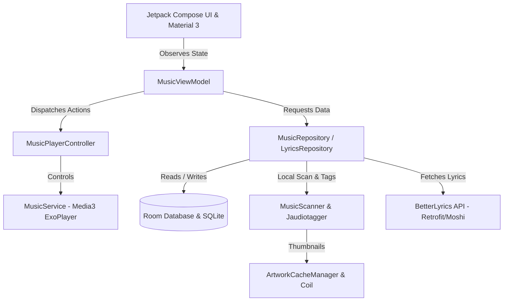

# 🍀 Flora Music

<div align="center">

**A modern, feature-packed local music player for Android built with Jetpack Compose & Material 3.**  
Designed for music lovers and power users — featuring word-level synchronized lyrics, physical ID3 tag editing, dynamic palette theming, and a fully modular navigation system.

[](https://developer.android.com)
[](https://kotlinlang.org)
[](https://developer.android.com/jetpack/compose)
[](https://developer.android.com/media/media3)
[-blue?style=for-the-badge)](https://developer.android.com)
[-green?style=for-the-badge)](https://developer.android.com)

[Key Features](#-key-features) • [Screenshots & UI](#-ui-showcase) • [Architecture](#-architecture--tech-stack) • [Project Structure](#-project-structure) • [Getting Started](#-getting-started) • [Panduan Bahasa Indonesia](#-ringkasan-bahasa-indonesia)

</div>

---

## 🌟 Overview

**Flora Music** is an elegant, offline-first music player engineered with high-performance modern Android components. Unlike traditional players, Flora focuses on deep customizability and lyrics fidelity — offering real-time word-by-word karaoke synchronization, direct physical tag editing via Jaudiotagger, dynamic color adaptation from album artwork, and fully customizable tabs.

---

## ✨ Key Features

### 🎵 1. Advanced Audio & Playback Engine
- **AndroidX Media3 (ExoPlayer 1.4.1)**: Rock-solid local audio decoding with low latency and gapless support.
- **Background Playback & Foreground MediaService**: Continuous playback with system notifications, lockscreen controls, and `MediaLibraryService` compatibility.
- **Audio Intent Integration**: Supports voice and intent searches (`MEDIA_PLAY_FROM_SEARCH`, `SEARCH`).
- **Sleep Timer**: Built-in sleep timer with presets to automatically fade and stop playback.
- **Playback Speed Controller**: Quick presets for variable playback speeds (0.5x – 2.0x).
- **Interactive Queue Manager**: Reorder, remove, or jump to any song in the active playback queue.

### 🎤 2. Word-Level Synchronized Lyrics (BetterLyrics)
- **BetterLyrics API Integration**: Automatic online fetching for time-synchronized lyrics via the BetterLyrics service.
- **TTML XML Parser**: Parses syllable/word-level time tags into precise sub-frame timestamps.
- **Word-Level Karaoke Highlighting**: Smooth real-time color fill animations with grapheme cluster awareness and Right-to-Left (RTL) language handling.
- **Offline Caching**: Downloaded lyrics are persistently cached in a local SQLite database (Room).
- **Smart Fallback**: Seamless fallback to embedded synchronized (`SYLT`/LRC) or unsynced (`USLT`) tags inside the physical audio files.

### 🎨 3. Deep Lyrics & Visual Customization
- **Dynamic Theming**: Extracts dominant colors in real time from album artwork using **AndroidX Palette** to colorize lyric highlights and player backgrounds.
- **Custom Color Pickers**: Interactive HSV/Hue sliders and hex code inputs for both active and inactive lyric lines.
- **Custom Typography**: Pick system fonts (Serif, Sans-Serif, Monospace, Cursive) or import your own **`.ttf` / `.otf`** font files directly via Android's Storage Access Framework (SAF).
- **Layout Fine-Tuning**: Adjust active and non-active font sizes, alignment (Left, Center, Right), anchor position (Top, Center, Bottom), margins, and line height multipliers.
- **Fluid Spring Animations**: Custom bounce-click interactions and smooth swipe gestures.

### 🏷️ 4. Physical ID3 Tag & Metadata Editor
- **Direct File Modification**: Powered by **Jaudiotagger 3.0.1**, edits are committed directly into physical audio files on disk (MP3, FLAC, M4A, etc.).
- **Editable Metadata Fields**: Title, Artist, Album, Composer, Genre, Writer, Year, Track Number, Disc Number, and Comments.
- **Embed Custom Lyrics**: Write custom lyrics into the file's ID3 tags.
- **Embed Custom Artwork**: Pick an image from your device gallery to replace or inject new album artwork directly into the physical audio file, with automatic cache invalidation.

### 📑 5. Fully Configurable Tab Navigation
- **Flexible Navigation Builder**: Personalize the tab bar layout to suit your habits.
- **Tab Hierarchy Roles**:
  - `MAIN`: Primary navigation tab.
  - `SUB`: Nested sub-tab within a parent module.
  - `HIDDEN`: Hide unused modules from the UI.
  - `HEADER`: Visual section divider.
- **Custom Tabs & Icon Picker**: Create custom tabs and assign customized vector icons.
- **Default Modules**: Beranda (Favorites, History, Top Played), Songs, Albums, Artists, and Collections (Playlists, Genres).

### ⚡ 6. High-Performance Media Scanning & Caching
- **Fast Media Scanner**: Scans device audio with real-time progress reporting.
- **Artwork Pre-Extractor Service**: Background service that pre-extracts and downsamples album covers upon library scan.
- **Multi-Tier LRU Disk Cache**: Custom `ArtworkCacheManager` combined with Coil ensures zero stutter when scrolling large libraries.
- **Folder Blacklist / Exclusion**: Easily exclude ringtones, voice notes, WhatsApp audio, or system sound folders from your library.
- **Custom Artist / Album Covers**: Override artist and album thumbnails independently from the gallery without modifying physical files.
- **View Toggle**: Switch effortlessly between Grid and List views.

---

## 🏗️ Architecture & Tech Stack

Flora follows modern Android Architecture guidelines with **MVVM**, **Repository Pattern**, and uni-directional reactive data flow.



| Layer | Technologies |
|---|---|
| **User Interface** | Jetpack Compose, Material 3, Compose Navigation, Material Icons Extended |
| **Architecture** | MVVM, Clean Architecture, Kotlin Coroutines, `StateFlow` / `SharedFlow` |
| **Media & Audio** | AndroidX Media3 ExoPlayer (`1.4.1`), AndroidX MediaSession |
| **Metadata & Tagging** | Jaudiotagger (`3.0.1`) |
| **Local Persistence** | Room Database (`2.7.0`) with KSP, SharedPreferences |
| **Networking & Parsing**| Retrofit (`2.12.0`), OkHttp (`4.10.0`), Moshi Kotlin (`1.15.2`), TTML XML Parser |
| **Image Loading & Color**| Coil Compose (`2.7.0`), AndroidX Palette (`1.0.0`) |
| **Target Platforms** | Android 7.0+ (API 24) to Android 15 (API 36) |

---

## 📁 Project Structure

```text
Flora-Music/
├── app/
│   ├── src/
│   │   ├── main/
│   │   │   ├── java/com/example/
│   │   │   │   ├── data/
│   │   │   │   │   └── repository/        # LyricsRepository & caching logic
│   │   │   │   ├── database/              # Room Database, DAOs, and Entities
│   │   │   │   ├── domain/
│   │   │   │   │   ├── model/             # Domain entities (Song, Playlist, LyricsData)
│   │   │   │   │   └── provider/          # Lyrics providers (BetterLyricsProvider)
│   │   │   │   ├── lyrics/                # TTML parser, LRC parser, LyricsEngine
│   │   │   │   ├── network/               # Retrofit API definitions & models
│   │   │   │   ├── player/                # Media3 ExoPlayer controller & MusicService
│   │   │   │   ├── presentation/          # Jetpack Compose UI screens, sliders & ViewModel
│   │   │   │   │   ├── FloraUI.kt         # Main navigation, tabs, and list/grid layouts
│   │   │   │   │   ├── FloraPlayerUI.kt   # Player sheet, queue, tag editor & word-level lyrics
│   │   │   │   │   ├── FloraLyricsSettingsUI.kt  # Lyrics customization screen
│   │   │   │   │   ├── FloraTabSettingsUI.kt     # Tab management screen
│   │   │   │   │   └── MusicViewModel.kt  # Central application state & business logic
│   │   │   │   ├── repository/            # MusicRepository (songs, playlists, scanning)
│   │   │   │   ├── service/               # ArtworkPreExtractorService
│   │   │   │   ├── ui/theme/              # Material 3 colors, typography, theme
│   │   │   │   ├── utils/                 # ArtworkCacheManager, MusicScanner, AudioArtworkFetcher
│   │   │   │   ├── FloraApplication.kt    # Base Application class & Coil image loader setup
│   │   │   │   └── MainActivity.kt        # Single activity host & media intent handler
│   │   │   ├── res/                       # Drawables, mipmaps, strings, themes
│   │   │   └── AndroidManifest.xml        # Permissions, services, and activity definitions
│   │   └── test/                          # Unit and Robolectric tests
│   ├── build.gradle.kts                   # App module build configuration
│   └── proguard-rules.pro                 # ProGuard / R8 rules
├── BetterLyrics/                          # BetterLyrics standalone module & TTML tests
├── gradle/
│   └── libs.versions.toml                 # Version catalog for dependencies and plugins
├── build.gradle.kts                       # Root build configuration
├── settings.gradle.kts                    # Gradle settings & plugin management
├── .env.example                           # Template for secret keys
└── README.md                              # Project documentation
```

---

## 🚀 Getting Started

### Prerequisites
- **Android Studio**: Android Studio Ladybug (2024.2.1+) or newer.
- **Java Development Kit (JDK)**: JDK 17 or JDK 21.
- **Android SDK**:
  - `minSdkVersion`: 24 (Android 7.0 Nougat)
  - `targetSdkVersion`: 36 (Android 15)
  - `compileSdk`: 36

### Configuration
1. Clone the repository:
   ```bash
   git clone https://github.com/your-username/Flora-Music.git
   cd Flora-Music
   ```

2. Setup environment variables (optional for secrets plugin):
   ```bash
   cp .env.example .env
   ```

3. Open the project in **Android Studio** and let Gradle synchronize the dependencies.

### Building & Running
- **Debug Build**:
  ```bash
  ./gradlew assembleDebug
  ```
- **Run Unit Tests**:
  ```bash
  ./gradlew test
  ```
- Or run directly on your connected device / emulator via Android Studio (`Shift + F10`).

---

## 🔒 Permissions Used

Flora requests the following permissions to provide full offline player functionality:
- `READ_MEDIA_AUDIO` / `READ_EXTERNAL_STORAGE`: To index and play audio files from local storage.
- `WRITE_EXTERNAL_STORAGE` / `MANAGE_EXTERNAL_STORAGE`: Required by Jaudiotagger to write ID3 metadata changes and embed artwork directly into physical audio files.
- `FOREGROUND_SERVICE` & `FOREGROUND_SERVICE_MEDIA_PLAYBACK`: For uninterrupted background playback.
- `POST_NOTIFICATIONS`: To show playback controls in the system notification shade.
- `INTERNET` & `ACCESS_NETWORK_STATE`: For fetching synchronized lyrics from the BetterLyrics API.
- `WAKE_LOCK`: To prevent CPU sleep while playing audio.

---

## 🇮🇩 Ringkasan Bahasa Indonesia

**Flora Music** adalah aplikasi pemutar musik lokal Android berbasis **Jetpack Compose** dan **Material 3** dengan segudang fitur modern:
1. **Word-Level Synchronized Lyrics**: Menampilkan lirik lagu tersinkronisasi kata-demi-kata (gaya karaoke) secara langsung via integrasi BetterLyrics API, parser TTML, dan fallback lirik ID3 offline.
2. **Editor Tag Metadata Fisik**: Mengubah metadata lagu (Judul, Artis, Album, Genre, Lirik, hingga Album Art) langsung ke dalam file audio fisik di memori perangkat menggunakan pustaka `jaudiotagger`.
3. **Kustomisasi Tampilan Mendalam**: Warna lirik otomatis menyesuaikan sampul album (*Dynamic Palette*), pemilihan font kustom (bisa memasukkan file `.ttf`/`.otf` sendiri), serta pengaturan ukuran, margin, dan posisi baris aktif.
4. **Sistem Tab Modular**: Tata letak tab aplikasi dapat diatur sesuka hati (pindah posisi, jadikan subtab, buat tab kustom dengan ikon pilihan, atau sembunyikan).
5. **Performa Mulus & Caching Pintar**: Didukung AndroidX Media3 ExoPlayer, pra-ekstraksi album art di latar belakang, serta fitur blacklist folder (menyembunyikan rekaman suara, audio WhatsApp, dsb.).

---

## 📄 License & Credits

- Built with ❤️ using modern Android standards.
- Synchronized lyrics powered by [BetterLyrics](https://lyrics-api.boidu.dev/).
- Audio tagging powered by [Jaudiotagger](https://www.jthink.net/jaudiotagger/).
